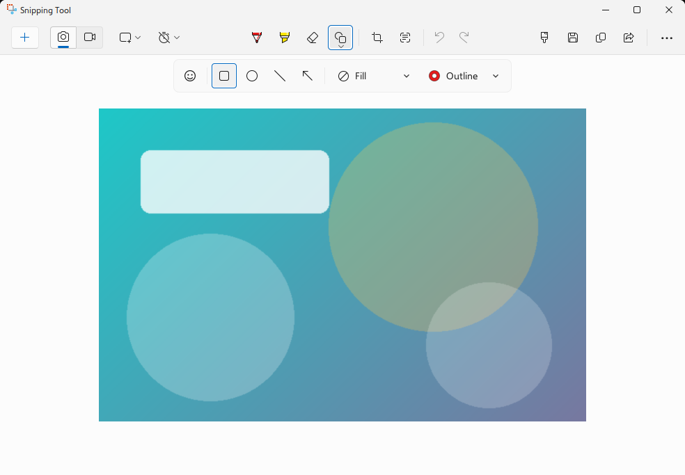
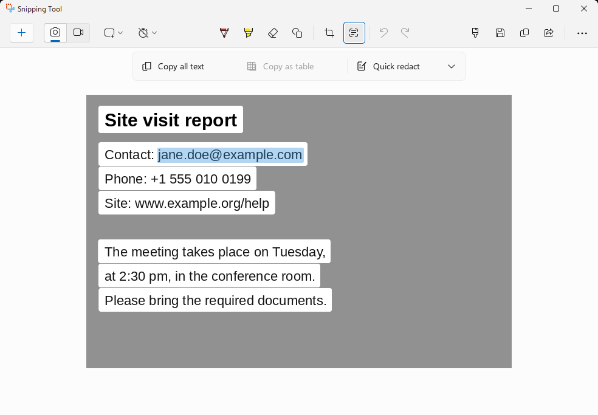
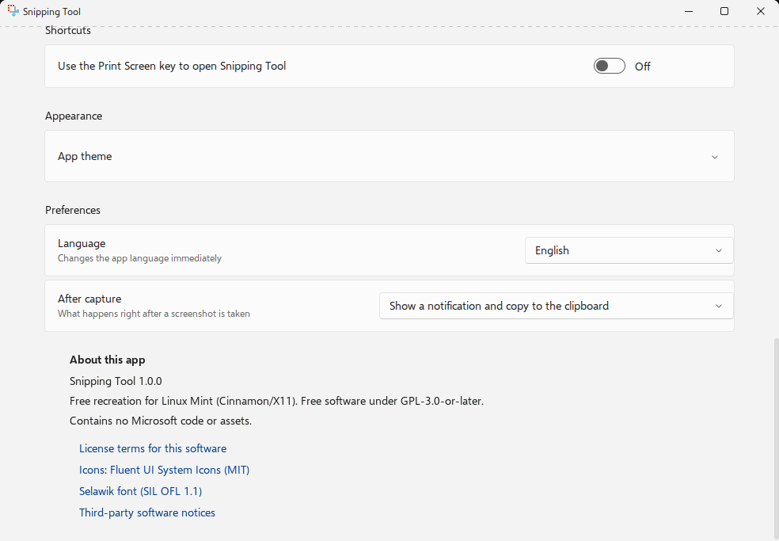
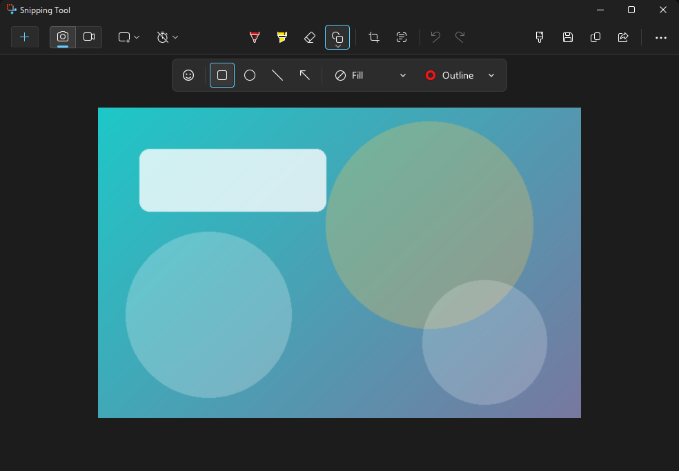

# Win11-like Snipping Tool for Linux

[](https://github.com/Grekto-dev/Win11-like-Snipping-Tool/actions/workflows/ci.yml)
[](LICENSE)

An independent re-creation of the **Windows 11 Snipping Tool** for Linux (GTK 3, Python, X11), built by measuring a real Windows 11 reference side by side: layouts, colours, animations and behaviour were compared pixel by pixel and frame by frame. Tested on Linux Mint (Cinnamon).

> **This project is unofficial and is not affiliated with, endorsed by or sponsored by Microsoft.** The application code is original. See [Third-party components](#third-party-components).

<p align="center">
  
  
</p>

## Features

- **Capture**: rectangle, window, full-screen and freeform snips, with a 3, 5 or 10 second delay.
- **Editor**: pen, highlighter, eraser, shapes, crop, ruler, emoji, undo/redo, zoom, and light and dark themes.
- **Text actions (OCR)**: powered by Tesseract. Select words or lines, copy all text, copy as a table, redact email addresses and phone numbers, read QR codes. The text extractor also runs directly inside the capture overlay and closes the app after copying when started with `--capture`.
- **Optimized OCR**: persistent Tesseract workers and bounded CPU threads reduce recognition overhead while retaining the published recognition settings. See measurements and compatibility checks in [`docs/OCR_PERFORMANCE.md`](docs/OCR_PERFORMANCE.md); real old-PC validation is still needed.
- **Screen recording**: FFmpeg-based region recording with pause/resume, microphone and system audio.
- **After capture** (*Settings → Preferences*): show a notification **and** copy to the clipboard (default), show a notification only, only copy to the clipboard, or open the editor.
- **Languages**: English (default), Portuguese (Brazil), Chinese, Japanese, Spanish, French and Italian. Switching the language applies immediately.
- **Settings** modelled on the original page: capture, recording, preferences, appearance and about, with the app version (1.0.1).

<p align="center">
  
  
</p>

## Install

### Debian, Ubuntu and Linux Mint (`.deb`)

Download `captura_<version>_all.deb` from the [latest release](https://github.com/Grekto-dev/Win11-like-Snipping-Tool/releases/latest) and install it:

```bash
sudo apt install ./captura_1.0.1_all.deb
```

Verify the download with `sha256sum -c captura_1.0.1_all.deb.sha256`. The package installs the `captura` command and a desktop entry named *Snipping Tool*.

The package recommends `tesseract-ocr` (text extraction), `ffmpeg` (recording), `libzbar0` (QR codes) and `pulseaudio-utils` (audio device detection). For OCR in other languages, install the matching `tesseract-ocr-*` language packs.

### From source

```bash
sudo apt install python3-gi python3-gi-cairo python3-cairo gir1.2-gtk-3.0 gir1.2-wnck-3.0 \
  gir1.2-notify-0.7 librsvg2-common tesseract-ocr ffmpeg libzbar0
git clone https://github.com/Grekto-dev/Win11-like-Snipping-Tool.git
cd Win11-like-Snipping-Tool
./bin/captura
```

## Usage

```bash
captura                 # main window
captura --snip          # capture overlay
captura --capture       # start directly in capture mode (like clicking New);
                        # with the text extractor, the app exits after copying
captura --ocr           # text extractor
captura --color         # colour picker
captura --record        # screen recording
captura --settings      # open Settings
captura --fullscreen    # capture the whole screen immediately
captura --background    # stay resident without a window
captura --version
```

Turn on *Settings → Use the Print Screen key to open Snipping Tool* to bind `captura --snip` to Print Screen (Cinnamon custom keybinding).

Settings are stored in `~/.config/captura/`. Set `CAPTURA_LANG` (for example `CAPTURA_LANG=pt-BR`) to override the interface language for a single run.

## Requirements and limitations

- X11 only (Cinnamon, MATE, Xfce, GNOME on Xorg, ...). Wayland is not supported because screen capture relies on X11.
- The Share menu is the system's menu rather than the Windows share sheet, and the Windows-only *HDR colour corrector* setting does not exist.
- The recording options *copy edits automatically* and *ask to save edited recordings* are shown for parity but have no effect, because recordings cannot be edited yet.
- Recordings take about half a second to produce their first frame, so a file can be slightly shorter than the on-screen timer. If the app is killed with `SIGKILL` during a recording, the partial MP4 may be unplayable.
- The translations were produced with the help of a language model and have not had human review. Corrections are welcome.

## Development

```bash
# run the whole suite (needs an X server; use a throw-away config directory)
cfg=$(mktemp -d)
DISPLAY=:0 XDG_CONFIG_HOME="$cfg" python3 -m unittest discover -s tests

# check that every UI string is in the translation catalogs
python3 scripts/extract_i18n.py

# build the .deb into dist/
scripts/build-deb.sh
```

The interaction tests drive real X11 events (XTEST), so run only one suite at a time on a given display. Dependencies for the tests: `python3-xlib`, `python3-qrcode`, `tesseract-ocr`, `ffmpeg`, `libzbar0` and `xclip`. Visual-comparison notes and measurements are in [`docs/`](docs/).

## License and attribution

The application code is licensed under **GPL-3.0-or-later**; see [`LICENSE`](LICENSE). Third-party components keep their own licenses and notices.

### Third-party components

| Component | Owner / source | License |
|---|---|---|
| Fluent UI System Icons | Microsoft Corporation | MIT: [`third_party/LICENSE-fluentui-system-icons.txt`](third_party/LICENSE-fluentui-system-icons.txt) |
| Selawik (font) | Microsoft Corporation | SIL OFL 1.1: [`third_party/LICENSE-selawik-OFL.txt`](third_party/LICENSE-selawik-OFL.txt) |

`ic_fluent_timer_5_20_regular.svg` is a local adaptation of the library's 3-second timer with a redrawn numeral. Paths, modifications and sources are listed in [`THIRD_PARTY_NOTICES.md`](THIRD_PARTY_NOTICES.md). The remaining icons under `captura/data/icons/custom/` are original drawings; no glyphs or images were extracted from the proprietary Windows application. Screenshots in this README use a sample image created for this project.

*Windows* and *Snipping Tool* are trademarks of Microsoft Corporation, used here only to identify the application this project is inspired by.
